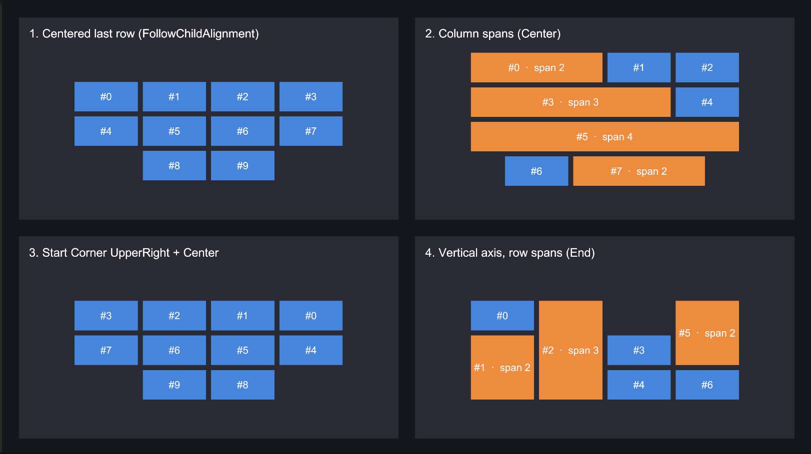
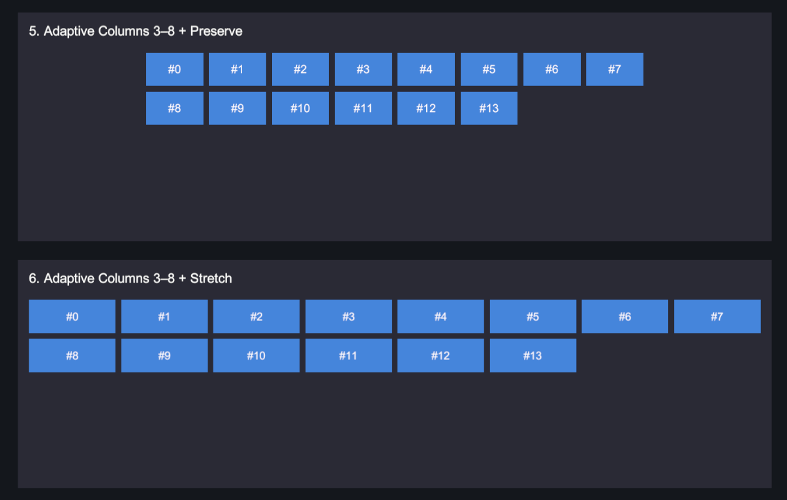

# Dynamic Grid Layout Group

A `GridLayoutGroup` for Unity UI (uGUI) that adapts to its content and to the screen size.

**[📖 Documentation](Documentation~/DynamicGridLayoutGroup.md)** · [Changelog](CHANGELOG.md) · [License](LICENSE.md)

## Features

- **Spanning cells**: an item can take 2, 3… columns (or rows).
- **Partial line alignment**: center (or align) a last row that isn't full.
- **Adaptive columns/rows**: between a minimum and a maximum, depending on the available space.
- **Cell sizing**: fixed size, stretched to fill, or each column/row sized to its content.

## Examples

Centered last row, cells spanning several columns or rows, and a grid filled from the upper-right corner:



Between 3 and 8 columns depending on the width; cells keep their size (Preserve) or stretch to fill the row (Stretch):



## Installation

*Package Manager → + → Install package from git URL…*

```
https://github.com/nosmow/DynamicGridLayoutGroup.git#v1.0.0
```

Requires Unity 2021.3+. A `.unitypackage` and a `.tgz` are also available in *Releases*.

## Quick start

1. **Add Component → Layout → Dynamic Grid Layout Group** on a UI object (or right-click an existing `GridLayoutGroup` → **Convert to Dynamic Grid Layout Group**).
2. Add the items as children.
3. Add **Layout → Grid Layout Cell** to any child that should span several columns.

```csharp
grid.adaptiveConstraint = GridAdaptiveConstraint.Columns;
grid.minCount = 2;
grid.maxCount = 6;
grid.cellSizeMode = GridCellSizeMode.Stretch;
```

Import the **Demo** sample from the Package Manager to see every feature in action.

👉 Options, how it works, common setups and API: **[Documentation](Documentation~/DynamicGridLayoutGroup.md)**

## License

[MIT](LICENSE.md) © nosmow
